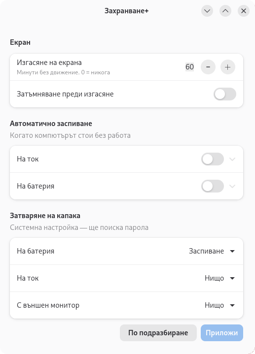

# power-marka / Захранване+

> Formerly **Power Plus** (`power-plus`). The new package replaces the old one and keeps your lid setting.

The power settings GNOME hides — in one small window.

- **Screen blank** after any number of minutes (GNOME Settings stops at 15) or never
- **Automatic suspend** on AC and on battery, with your own timeout
- **Laptop lid**: suspend / lock only / do nothing / power off / hibernate —
  separately on battery, plugged in and with an external monitor

Bulgarian and English interface. GTK4 + libadwaita, fits right into GNOME.

## Install (Debian 13 / Ubuntu 24.04+)

Download the `.deb` from [Releases](https://github.com/nikogurzov/power-marka/releases/latest), then:

    sudo apt install ./power-marka_1.0.1_all.deb

Open **power-marka** (Захранване+) from the app grid.

## How it works

- Screen and suspend settings are normal GNOME settings (gsettings), changed instantly, no password.
- Lid settings are system-wide (systemd-logind). They are written to
  `/etc/systemd/logind.conf.d/50-power-marka.conf` by a tiny helper through polkit,
  so it asks for your password once. "Defaults" removes the file.
  logind is reloaded with SIGHUP — your session is not closed.

## Uninstall

    sudo apt purge power-marka    # also removes the lid file

License: GPL-3.0-or-later · https://tech.palamarka.com
